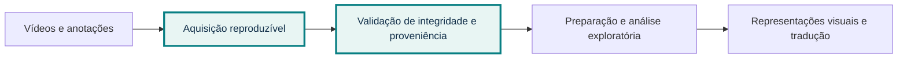

  <svg class="cover-mark" viewBox="0 0 64 64" role="img" aria-label="Símbolo abstrato de movimento e conexão">
    <path d="M6 39c12 0 12-20 25-20s13 22 27 22" fill="none" stroke="currentColor" stroke-width="4" stroke-linecap="round" />
    <circle cx="8" cy="39" r="4" fill="currentColor" />
    <circle cx="57" cy="41" r="4" fill="currentColor" />
  </svg>
  <h1>Progresso da pesquisa</h1>
  
Atualização para discussão com pesquisadores

  
Aprendizado profundo de representações visuais para tradução de Libras para português escrito sem glosas

  

  
Retrato de evidências · {{ $date($release.release_date) }}

<!--
Apresentação de acompanhamento científico. As datas das evidências são distintas e aparecem em cada resultado.
Não há resultados de treinamento ou de qualidade de tradução nesta etapa.
-->

---

# A base empírica está sendo auditada antes dos experimentos

O avanço desta etapa é transformar {{ $fmt($latest.technical_summary.videos_seen) }} registros examinados em evidências técnicas rastreáveis.

  <MetricCard label="MINDS-Libras" :value="`${$fmt($mind?.counts.physical_videos)} vídeos`" :detail="`Resumo de qualidade: ${$mind?.decision || 'sem decisão registrada'}.`" accent="teal" />
  <MetricCard label="Coincidências de fps com frames" :value="$fmt($latest.technical_summary.fps_frame_count_matches)" detail="Contagem no resumo técnico da execução mais recente." accent="blue" />
  <MetricCard label="V-LIBRASIL" :value="`${$fmt($vlibrasil?.counts.issues)} ocorrências`" :detail="`Resumo disponível: ${$vlibrasil?.decision || 'sem decisão registrada'}.`" accent="purple" />

<SourceNote source="artifacts/reports/publications/2026-10-25-baseline.json" detail="síntese derivada; veja a data própria de cada dataset" />

---

# O que estamos preparando para investigar?

Investigar representações visuais aprendidas por modelos profundos para apoiar a tradução de Libras para português escrito sem glosas.

Etapa atual: aquisição e validação dos dados. EDA aprofundada, treinamento e avaliação de tradução ainda não estão representados como resultados.

---

# Um campo chamado `fps` pode ter mais de uma interpretação

  

    
Se o valor for tratado como quadros por segundo sem confirmação, a leitura temporal e a amostragem dos vídeos podem ficar incorretas.

    <ul class="next-list">
      <li>Comparar CSV com metadados observados nos vídeos.</li>
      <li>Testar taxa real e contagem de frames como hipóteses distintas.</li>
      <li>Preservar o valor original e registrar a interpretação sustentada pela evidência.</li>
    </ul>
  

  

    <h2>Critério desta etapa</h2>
    
GO/NO-GO trata da integridade e da proveniência dos dados.

    
<strong>Não mede</strong> qualidade linguística, qualidade de tradução ou desempenho de modelo.

  

<SourceNote source="specs/003-validar-metadados-video/" detail="contrato e tarefas de validação" />

---

# A inspeção técnica dos metadados foi concluída

  <MetricCard label="Vídeos observados" :value="$fmt($latest.technical_summary.videos_seen)" :detail="`${$fmt($latest.technical_summary.videos_with_probe_error)} falhas de inspeção · ${$fmt($latest.technical_summary.videos_partial)} resultados parciais`" accent="blue" />
  <MetricCard label="Correspondências de largura" :value="$fmt($latest.technical_summary.width_matches)" detail="Valor do CSV corresponde ao vídeo." accent="teal" />
  <MetricCard label="Correspondências de altura" :value="$fmt($latest.technical_summary.height_matches)" detail="Valor do CSV corresponde ao vídeo." accent="purple" />

  
<h2 style="margin-bottom:.25rem">Resultado do resumo de qualidade</h2>
{{ $fmt($mind?.counts.issues) }} ocorrências: {{ $fmt($mind?.counts.by_severity.CRITICAL) }} CRITICAL · {{ $fmt($mind?.counts.by_severity.ERROR) }} ERROR · {{ $fmt($mind?.counts.by_severity.WARNING) }} WARNING · {{ $fmt($mind?.counts.by_severity.INFO) }} INFO.

  <DecisionBadge :decision="$mind?.decision || 'UNKNOWN'" />

<SourceNote :source="`MINDS-Libras · resumo de qualidade ${$evidenceDateMind}`" :detail="`inspeção técnica resumida na execução de ${$date($latest.executed_at)}`" />

---

# Como o campo `fps` se relaciona com os vídeos?

  <DataComparison
    title="Hipóteses comparadas no resumo mais recente"
    :items="[
      { label: 'Taxa real', value: $latest.technical_summary.fps_rate_matches, display: `${$fmt($latest.technical_summary.fps_rate_matches)} / ${$fmt($latest.technical_summary.videos_seen)}`, accent: 'blue' },
      { label: 'Contagem de frames', value: $latest.technical_summary.fps_frame_count_matches, display: `${$fmt($latest.technical_summary.fps_frame_count_matches)} / ${$fmt($latest.technical_summary.videos_seen)}`, accent: 'teal' }
    ]"
    :max="$latest.technical_summary.videos_seen"
    caption="A classificação indica a hipótese que coincide com o campo original; não renomeia nem altera o CSV."
  />
  

    
Nos {{ $fmt($latest.technical_summary.videos_seen) }} registros avaliados, {{ $fmt($latest.technical_summary.fps_rate_matches) }} coincidiram com a taxa real e {{ $fmt($latest.technical_summary.fps_frame_count_matches) }} com o número de frames.

    
Tolerância para comparação da taxa: {{ $latest.technical_summary.fps_tolerance }}.

  

<SourceNote source="harness/artifacts/reports/latest.json" :detail="`execução ${$date($latest.executed_at)} · dataset ${$latest.dataset}`" />

---

# Resumo de proveniência do V-LIBRASIL

  <MetricCard label="Vídeos físicos" :value="$fmt($vlibrasil?.counts.physical_videos)" :detail="`Resumo de qualidade gerado em ${$evidenceDateVlibrasil}.`" accent="blue" />
  <MetricCard label="Ocorrências CRITICAL" :value="$fmt($vlibrasil?.counts.by_severity.CRITICAL)" :detail="`${$fmt($vlibrasil?.counts.provenance?.error_missing_file)} registros em error.csv sem arquivo físico correspondente.`" accent="purple" />
  <MetricCard label="Ocorrências ERROR" :value="$fmt($vlibrasil?.counts.by_severity.ERROR)" detail="Exigem inspeção no relatório de issues para classificar a causa." accent="teal" />

  <DecisionBadge :decision="$vlibrasil?.decision || 'UNKNOWN'" />
  
O resumo registra {{ $fmt($vlibrasil?.counts.provenance?.error_rows) }} linhas em `error.csv`; {{ $fmt($vlibrasil?.counts.provenance?.error_in_annotations) }} constam em `annotations.csv` e {{ $fmt($vlibrasil?.counts.provenance?.error_with_physical_file) }} têm vídeo físico correspondente.

<SourceNote source="V-LIBRASIL · metadata_summary.json" :detail="`evidência de ${$evidenceDateVlibrasil}; não comparar como se tivesse sido gerada junto ao MINDS`" />

---

# Os datasets estão em estados de validação diferentes

  

    <h2>MINDS-Libras</h2>
    
<DecisionBadge :decision="$mind?.decision || 'UNKNOWN'" />

    
{{ $fmt($mind?.counts.annotations) }} anotações · {{ $fmt($mind?.counts.physical_videos) }} vídeos · {{ $fmt($mind?.counts.manifest_rows) }} linhas no manifest.

    
Resumo de qualidade: {{ $evidenceDateMind }}.

  

  

    <h2>V-LIBRASIL</h2>
    
<DecisionBadge :decision="$vlibrasil?.decision || 'UNKNOWN'" />

    
{{ $fmt($vlibrasil?.counts.annotations) }} anotações · {{ $fmt($vlibrasil?.counts.physical_videos) }} vídeos · {{ $fmt($vlibrasil?.counts.manifest_rows) }} linhas no manifest.

    
Resumo de qualidade: {{ $evidenceDateVlibrasil }}.

  

GO/NO-GO resume os critérios técnicos e de proveniência registrados em cada dataset. As datas diferem.

---

# O que já sabemos — e o que ainda não foi medido

  

    <h2>Com evidência disponível</h2>
    <ul class="next-list">
      <li>{{ $fmt($latest.technical_summary.videos_ok) }} dos {{ $fmt($latest.technical_summary.videos_seen) }} vídeos da execução foram aprovados na inspeção técnica.</li>
      <li>A hipótese mais compatível com `fps` foi “{{ $latest.technical_summary.dataset_fps_interpretation }}” nesta comparação.</li>
      <li>O resumo de proveniência do V-LIBRASIL registra decisão {{ $vlibrasil?.decision || 'sem decisão' }}.</li>
    </ul>
  

  

    <h2>Sem evidência nesta etapa</h2>
    <ul class="next-list">
      <li>Qualidade de tradução automática.</li>
      <li>Desempenho de modelos ou comparação de arquiteturas.</li>
      <li>Conclusões de EDA, balanceamento ou generalização.</li>
    </ul>
  

As conclusões desta apresentação se limitam às validações técnicas e de proveniência citadas.

---

# Estado de implementação e estado formal da feature

  <MetricCard label="Tarefas concluídas" :value="`${$fmt($progress.tasks_complete)} / ${$fmt($progress.tasks_total)}`" detail="Checkboxes de tasks.md no snapshot desta apresentação." accent="teal" />
  <MetricCard label="Status do spec" :value="$progress.spec_status" detail="Status registrado no cabeçalho de spec.md." accent="purple" />
  <MetricCard label="Versão deste relato" :value="$date($release.release_date)" :detail="`Identificador: ${$release.release_id}`" accent="blue" />

O estado dos documentos Spec Kit é apresentado literalmente: conclusão das tarefas não altera automaticamente o status formal do spec.

---

# Próxima conversa: fechar as pendências antes de ampliar as conclusões

<ol class="next-list">
  <li>Examinar as {{ $fmt($vlibrasil?.counts.issues) }} ocorrências do V-LIBRASIL no relatório de issues e decidir a ordem de remediação.</li>
  <li>Confirmar o estado formal da feature 003 após revisar os artefatos e os resultados registrados.</li>
  <li>Definir o próximo marco de análise exploratória e preparação para experimentos.</li>
</ol>

  <h2>Pergunta para orientação</h2>
  
Devemos priorizar a resolução das pendências do V-LIBRASIL ou usar o MINDS como base para iniciar a próxima análise exploratória, mantendo o outro dataset em acompanhamento?

Detalhes: <a href="../../reports/latest.html">relatório mais recente</a> · <a href="../../validation/index.html">evidências dos datasets</a>.

---

# Evidências que sustentam este retrato

<ul class="next-list">
  <li>Resumo técnico mais recente: <code>harness/artifacts/reports/latest.json</code>.</li>
  <li>Resumo de qualidade e proveniência por dataset em <code>app/data/processed/metadata-validation/</code>.</li>
  <li>Escopo e estado da implementação: <code>specs/003-validar-metadados-video/</code>.</li>
  <li>Snapshot desta versão: <code>harness/artifacts/reports/publications/2026-10-25-baseline.json</code>.</li>
</ul>

Esta apresentação resume o que foi realizado até o checkpoint de 25/10/2026 e explicita onde a evidência termina.

Os arquivos brutos não são incluídos na publicação. Relatórios públicos e detalhes ficam no <a href="../../index.html">showroom da pesquisa</a>.

<!--
Fontes completas e notas estão nesta versão interna. O build HTML público usa --without-notes.
Se os dados forem atualizados, gere um novo snapshot com prepare-presentation-release.ts e crie um novo release; não substitua esta versão.
-->
